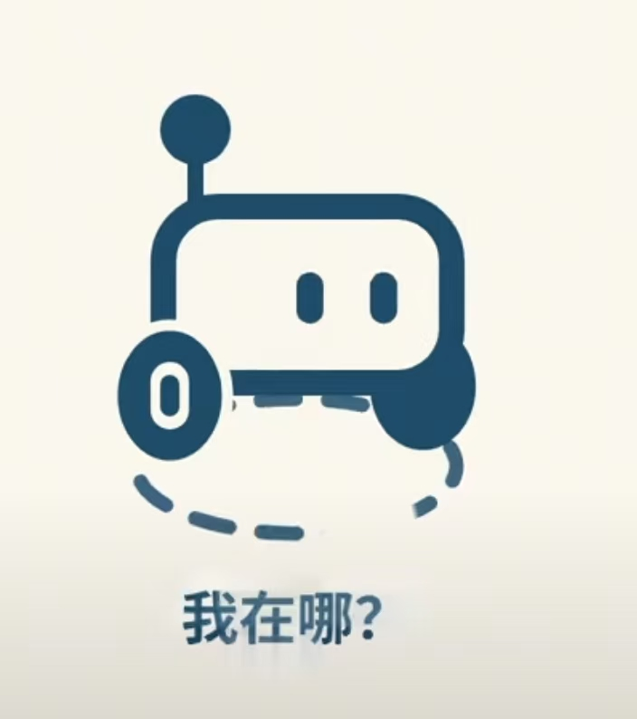
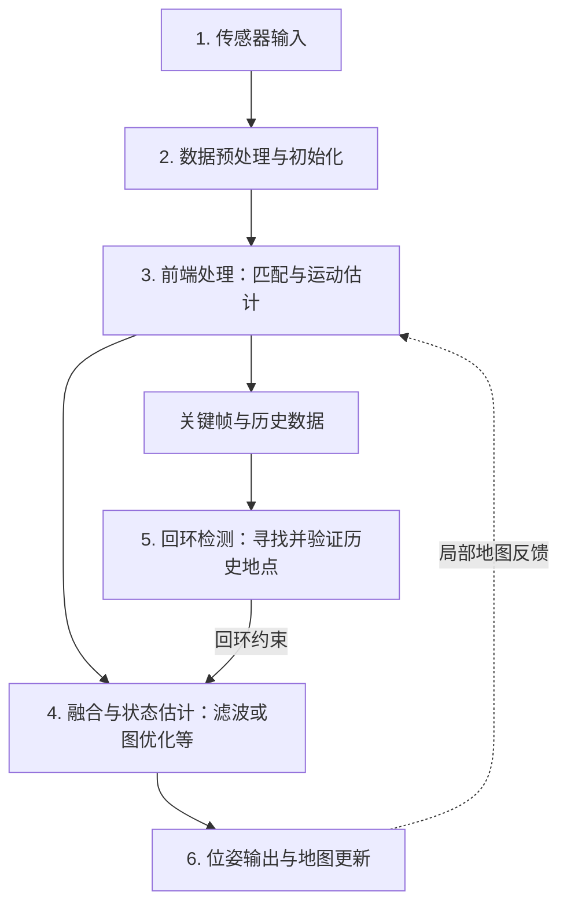

# 什么是SLAM 
**SLAM（Simultaneous localization and mapping同步建图和定位）** 是机器人领域最核心最经典的技术之一。SLAM可以辅助机器人执行路径规划、自主探索、导航等任务。

 

想象一下这一个情况，你是一个广美的新生这是你入学的第一天，现在你完全不知道广美内部到底长什么样，A栋教学楼在哪，1栋宿舍楼在哪，而此刻诺大的学校就只有你一个人。此时此刻，广美对于你来说就是一个完全陌生的环境，你边在学校里到处走走看看，知道了自己当前在广美生活区6号门，你往前走了50m，看到了右边是个生活超市，左边就是饭堂了；然后你的脑子记了下来，并构建了一个区域地图。然后你继续在校园里面到处走，同时你脑内的地图也在不断完善，你也记得你从出发点走了多少米，其中在哪左转/右转在哪上楼梯，并知道自己现在处于哪里（生活区/教学区，哪栋楼）。这个就是SLAM，通俗的来讲，SLAM回答两个问题：“我在哪儿？”“我周围是什么？”

**SLAM就是让机器人在完全陌生的环境里，一边走，一边画地图，同时还能知道自己在地图上的什么位置。** 
而机器人不像我们人类有眼睛能看到前面，有手臂能摸到周围墙壁。于是我们会在机器人上面装上传感器：激光雷达（感知周围的障碍物，并建立点云地图），里程计（根据自己的步幅估计自己走了多远），摄像头（看到周围环境，并与点云地图对应） 

SLAM主要承担环境感知与状态估计的工作，核心输出是：一张地图（例如二维占据栅格地图、三维点云地图），以及机器人在地图中的实时位姿。**位姿就是“位置 + 朝向”**，二维情况下通常用 `(x, y, θ)` 表示。

## SLAM流程详解

现在你手上有个很可爱的小机器人，它上面装了激光雷达、相机等等传感器，现在它在一个陌生的迷宫里面。它以前从来没来过这个地方，脑子里也没有相应的地图。 

 

先看一张SLAM流程图，再把每一步拆开讲：

**这套流程会随着新数据的到来不断运行，机器人边走边更新地图。** 回环检测和全局优化往往在后台进行，不需要等机器人走完一圈，前端才能继续工作。例如，Cartographer就将局部建图与全局优化分开运行。[Cartographer算法说明](https://google-cartographer-ros.readthedocs.io/en/latest/algo_walkthrough.html)

图中按功能拆分模块，是为了方便理解。实际系统中，融合可能发生在前端或后端；因子图优化本身就可以承担融合与后端估计的工作，不代表每套SLAM都必须依次经过EKF、因子图和另一个优化器。

### 1. 传感器输入

既然需要知道自己在哪并且构建地图，那么从外界获取信息是必须的。不同传感器提供的信息也不一样：

| 传感器 | 提供什么信息 | 需要注意什么 |
| --- | --- | --- |
| 激光雷达 | 周围物体的距离与轮廓，形成二维扫描或三维点云 | 玻璃、反光表面等可能导致异常测量，空旷或重复场景不容易匹配 |
| 相机 | 图像中的纹理、角点等视觉信息 | 容易受光照、遮挡和运动模糊影响；普通单目相机不能直接给出每个像素的距离 |
| RGB-D相机或双目相机 | 彩色图像与深度信息，或由左右图像计算深度 | 深度测量有有效范围，也可能存在缺失值 |
| 轮编码器 | 轮子的转角，结合轮径和底盘模型计算轮式里程计 | 打滑、轮径误差等会让估计的移动距离偏离真实值 |
| IMU惯性测量单元 | 角速度与加速度计读数，用于估计短时间内的运动变化 | 加速度计实际测量的是比力，估计运动时需要处理重力、姿态、偏置和噪声 |

我们可以把它们理解为：雷达和相机在“看周围”，轮编码器在“数轮子转了多少”，IMU在“感受自己如何转动和加速”。

这里要注意，**IMU不会直接告诉你走了多少米**。从惯性测量推算位移需要积分，微小的偏置也会逐渐积累成明显误差，所以通常需要其他观测来约束它。

机器人也不必把这些传感器全部装齐。激光SLAM、视觉SLAM、视觉惯性SLAM等系统会根据任务选择不同组合。

### 2. 数据预处理与初始化

现在，雷达、相机、轮编码器、IMU的数据都输入到了机器人内部，但是这些原始数据还不能直接拿来拼地图，需要先解决噪声、时间、坐标等问题。

#### 降噪与无效数据剔除

现实中采集到的数据并非完全理想，会有许多噪声。就像超声波传感器测量前方5m处的物体，即使物体和传感器都不动，返回的结果也可能在5m附近浮动。

因此，通常会先过滤超出有效测距范围的数据、无效深度值、明显孤立的点等，再根据需要使用滤波算法降低噪声影响。如果系统支持动态物体处理，还可以识别或剔除行人等运动物体的观测，减少它们对定位与静态地图的干扰。

不过，滤波不能把所有误差都修好。例如轮子打滑造成的是运动估计错误，仅仅把轮速数据变平滑，并不能得到真实位移。

#### 降采样

降采样就是减少参与计算的数据量，在保留主要环境结构的同时降低计算负担。

一帧三维点云可能包含数万甚至更多个点，每个点带有坐标，还可能带有反射强度、扫描线号、采样时间等信息；相机图像则包含大量像素。如果所有数据都参与复杂匹配，计算量会很大。

对于点云，常见的方法是**体素滤波**：把空间划成许多小立方体，同一个立方体里的多个点用一个代表点代替。例如PCL的VoxelGrid使用这些点的质心作为代表点。[PCL体素降采样教程](https://pointclouds.org/documentation/tutorials/voxel_grid.html) 

 

对于图像，可以缩小分辨率，或限制参与跟踪的特征数量。采样太密会增加计算量，采样太稀又可能丢掉墙角、细杆等有用结构，所以需要在速度和细节之间取舍。

#### 时间戳对齐

不同传感器采集数据的频率不一样。假设雷达每秒输出10帧，而IMU每秒输出200次读数，我们需要知道：**这一帧雷达扫描期间，对应的是哪一段IMU数据？**

常见处理包括统一时钟、校正传感器间的时间偏移，以及利用缓存和插值找到对应时刻的运动状态。对齐依据应当是采集时间，不能简单地把“同时到达程序”的两条消息当作同一时刻。

如果机器人正在转弯，却把较早的图像和较晚的姿态放在一起使用，即使各个传感器本身测量正常，也可能拼出歪斜的地图。

#### 标定与坐标关系

相机、雷达和IMU安装在机器人不同的位置，它们的“前方”和坐标原点可能都不一样。因此还要通过**外参标定**，确定传感器之间、传感器与机器人本体之间的旋转和平移关系。

比如雷达安装在机器人中心前方0.2m处，它测得“墙在前方2m”，不能直接当作“墙距离机器人中心2m”。只有考虑安装位置和朝向，才能把观测正确地转换到机器人或地图坐标系。

相机还需要内参，例如焦距、主点和镜头畸变参数，用于建立像素与空间方向的关系。这些参数通常提前标定，有些系统也支持运行时进一步估计。

#### 畸变去除

这里需要区分两类常见畸变：

- **相机镜头畸变**：由于镜头成像特性，现实中的直线可能在图像边缘变弯，可以根据标定参数进行校正。
- **激光扫描的运动畸变**：雷达的一帧点云通常不是同一瞬间采完的。如果扫描过程中机器人移动或转弯，直接把所有点当作同一位姿下的观测，一面平直的墙就可能被拼弯。

运动畸变补偿也叫去畸变或deskew。它利用每个点的采样时间，以及IMU、里程计等提供的运动估计，把各个点转换到同一个参考时刻。例如LIO-SAM使用点的相对时间和IMU数据进行点云去畸变。[LIO-SAM数据准备说明](https://github.com/TixiaoShan/LIO-SAM#prepare-lidar-data)

滚动快门相机也可能出现运动畸变，需要相应模型处理，不能把它和镜头畸变混为一谈。

#### 初始化

开始估计运动之前，还需要给系统一个起点。对于没有外部定位参考的机器人，通常可以把启动位置设为地图原点，初始朝向设为零；这里的原点是人为约定的，并不意味着机器人知道自己在地球上的经纬度。

带IMU的系统还可能需要估计初始重力方向、速度和偏置；视觉系统则需要建立最初的特征对应和地图。纯单目视觉通常不能独立确定真实的米制尺度，需要额外的尺度信息，例如深度或在合适运动条件下提供约束的IMU。

初始化通常发生在启动阶段，正常运行时不会每收到一帧就重设地图原点。跟踪丢失后是尝试重定位还是重新初始化，则取决于具体系统的设计。

### 3. 前端处理

好的，经过上面的处理，我们得到了可用的传感器数据。当前端已经有上一帧或一小块局部地图时，就可以回答：**和刚才相比，机器人移动了多少、转动了多少？**

可以把前端的工作理解为三个问题：找什么、对应谁、动了多少。

#### 特征提取：找什么

如果直接比较两张完整图像或两大堆点云，计算量很大，也不容易找到稳定的对应关系。因此，许多方法会先寻找有辨识度、能重复观测到的特征。

- **视觉特征**：图像中的角点、纹理明显的区域等，例如门框拐角、墙上的图案。ORB是一种常见的视觉特征。
- **激光特征**：点云中的边缘、平面等几何结构，例如墙角、地面、墙面。

但显式提取特征并不是所有SLAM的必经步骤。有些视觉方法直接利用像素亮度信息，有些激光方法直接对下采样后的点云进行配准。

#### 数据关联：对应谁

假设机器人在上一帧看到了一个门框，向前走一点后又看到了它。程序需要判断：**这一帧的这个门框，是不是上一帧的那个门框？** 这就是数据关联。

匹配对象可以是“当前帧和上一帧”，也可以是“当前帧和局部地图”。后者会利用最近一段时间积累的环境信息，不局限于相邻两帧。

视觉方法可以利用特征描述子或光流建立对应，再通过几何检验剔除误匹配；点云方法可以使用ICP等配准方法。ICP会反复寻找对应点、估计旋转和平移，再更新匹配，逐步减小点云之间的距离。[PCL的ICP教程](https://pointclouds.org/documentation/tutorials/iterative_closest_point.html)

ICP不是通用的图像特征匹配算法，也不是所有激光SLAM都只用ICP。如果初始位姿相差过大、环境重复或重叠区域太少，匹配可能失败，所以常用IMU、轮式里程计等提供运动初值，并检查匹配质量。

#### 运动估计：动了多少

找到可信的对应关系后，就可以求出使这些观测对齐的旋转和平移，进而得到机器人两次观测之间的相对运动。

比如经过匹配，估计机器人“向前移动了0.5m，同时向左转了5°”。在二维情况下，这个运动可以表示为相对位姿 `(Δx, Δy, Δθ)`。注意，位移量属于哪个坐标系必须说清楚，机器人前方不一定一直是地图的x轴方向。

把连续的相对运动按坐标关系组合起来，就得到一条局部轨迹。这类持续估计运动的模块称为**里程计**：根据图像估计的是视觉里程计，根据激光扫描估计的是激光里程计，根据轮编码器估计的是轮式里程计。

所以，“里程计”既可以指底盘提供的运动估计，也可以指前端计算运动的功能，并不只指某一个硬件传感器。

#### 关键帧与累计漂移

为了控制计算量，很多系统不会把每一帧都长期保存，而是在机器人移动一定距离、转过一定角度，或者看到了足够多新信息时，选取一帧作为**关键帧**，用于后续建图、优化和回环检测。

前端每次估计都会有一点误差。连续走过很多段路之后，小误差会累积成明显偏差，这就是**漂移**。例如机器人实际已经回到迷宫入口，估计的轨迹却停在入口旁边1m处，地图上的同一面墙也可能出现两层。

因此，仅靠不断累加相邻帧的运动，还不足以长期保持一致的地图。

### 4. 多传感器融合与状态估计

现在机器人有了多种线索：轮式里程计说前进了1m，雷达匹配认为前进了0.9m，IMU还提供了转动和加速的信息。机器人应该相信谁？

**融合不是把所有数字简单求平均，而是结合测量模型和不确定性，估计一个更合理的运动状态。** 不同传感器也未必测量同一种量，需要先把它们和待估计的状态联系起来。

比如轮子打滑时，轮编码器仍然记录到了转动，但雷达看到机器人与墙的相对位置几乎没变。两者结合后，系统就有机会修正单靠轮式里程计得到的错误位移。

#### 基于滤波的方法：预测与校正

以扩展卡尔曼滤波（EKF）为例，可以先理解两个动作：

1. **预测**：根据上一时刻的状态、运动模型以及IMU或轮式里程计等输入，预测机器人现在的位置、朝向、速度等，并更新不确定性。
2. **校正**：当雷达、视觉或地标观测等新信息到来时，根据预测与观测的差异，结合各自的不确定性修正状态。

可以把它想成：先根据步伐猜自己走到了哪里，再看看周围的墙和路口，修正刚才的猜测。具体哪些数据用于预测、哪些用于校正，取决于系统的建模方式。

另外，**把轮式里程计和IMU放进EKF，并不自动构成SLAM**。如果没有维护地图、没有利用环境观测建立定位与地图之间的联系，它仍然只是一个运动状态估计器。例如ROS的robot_localization提供的是传感器融合与状态估计功能。[robot_localization项目说明](https://github.com/cra-ros-pkg/robot_localization/blob/rolling-devel/doc/index.rst)

#### 基于图优化的方法：保留约束，联合求解

另一类方法会把一段时间里的状态和观测关系保留下来，构建位姿图或更一般的因子图。

可以先用位姿图理解：每个节点表示机器人某一时刻的位姿，节点之间的边表示一次相对运动测量。例如“A到B大约前进了1m、转了10°”，就是一条约束。

更一般的因子图中，**变量节点**还可以包含速度、IMU偏置、地标位置等；**因子节点**则表示里程计、视觉观测、IMU等带来的测量约束。它不是简单地把每条边都当成一条准确无误的事实，而是同时记录测量的不确定性。[GTSAM因子图教程](https://gtsam.org/tutorials/intro.html)

优化器会调整待估计的状态，让它们整体上尽量符合这些约束。融合多种传感器和后端优化，在这里可以通过同一个估计框架完成。

滤波和图优化是常见的状态估计思路，也可以组合使用；此外还有粒子滤波等方法。例如GMapping使用Rao-Blackwellized粒子滤波构建栅格地图。因此，上面的功能流程不能理解为所有算法都采用同一种内部结构。[OpenSLAM的GMapping说明](https://openslam-org.github.io/gmapping.html)

### 5. 回环检测与后端优化

前面提到，机器人走了一圈之后，估计的轨迹可能接不上。这时候，历史上观测过的环境就成了纠正漂移的重要线索。

#### 回环检测：这里是不是来过

假设机器人再次看到入口附近独特的墙角和柱子，系统可以尝试判断：“这个地方，我是不是之前来过？”

常见过程是：

1. **寻找候选地点**：用当前图像或点云的描述信息，在历史关键帧、历史子地图中检索相似场景。
2. **进行几何验证**：进一步匹配图像特征或点云，检查空间结构是否吻合，并估计两次观测之间的相对位姿。
3. **添加回环约束**：验证通过后，把当前位姿与历史位姿或子地图之间的相对关系加入后端。

“看起来像”只能产生候选，不能直接判定回环。迷宫里两个长得一样的路口，可能根本不是同一个地方；错误回环反而可能把地图拉坏。

回环也不要求机器人严格画一个圆。只要机器人再次观测到过去到过的区域，并建立可靠关联，就可能形成回环约束。

#### 后端优化：让整段轨迹尽量自洽

**回环检测负责发现和验证关联，后端优化负责利用约束调整状态。** 它们解决的是两个相关但不同的问题。

比如前端记录了一条轨迹 `A → B → C → D → E`，其中A是起点。机器人到达E时确认自己又回到了A附近，于是增加一条连接E与A的回环约束。实际约束记录的是两次观测之间的相对位姿，不要求两次停在完全相同的位置和朝向。

后端会综合相邻位姿之间的运动约束、回环约束以及其他可用观测，调整有关的历史位姿。它不会只是把最后一个点硬拉回起点，而是根据各个约束的可信程度，让整段轨迹更加一致。

优化时也需要固定参考，例如给初始位姿一个先验，否则整张相对地图一起平移或旋转，内部观测关系仍然一样，无法唯一确定地图放在哪里。

如果系统还把地标作为变量，可能同时优化位姿和地标；如果使用子地图，则可以优化子地图之间的位置关系。完成后，建图模块也要根据修正结果更新地图。[GTSAM中的位姿SLAM与回环约束](https://gtsam.org/tutorials/intro.html)

这里要记住两点：**没有回环时也可以进行局部优化或增量优化；出现回环后也只是进一步减少漂移，并不保证地图完全没有误差。**

### 6. 地图构建与更新

机器人知道了自己大概在哪，就可以把“我看到的东西”放到地图中；反过来，已经构建的地图又能帮助机器人判断下一帧的位置。这就是定位与建图相互依赖的地方。

#### 把观测放进地图坐标系

雷达测到的“前方2m有一面墙”，首先是传感器坐标系里的信息。要把它放进地图，需要结合传感器安装外参和机器人在地图中的位姿，进行旋转和平移变换。

如果已经求得传感器在地图中的旋转 `R` 和平移 `t`，一个观测点的位置可以写成：

$$
p_{map} = R p_{sensor} + t
$$

其中，`p_sensor`是点在传感器坐标系中的坐标，`p_map`是它在地图中的坐标。比如传感器位于地图的 `(2, 1)`，朝向与地图x轴一致，那么它前方2m处的点就在 `(4, 1)`；如果传感器逆时针转了90°，同样的“前方2m”就会落在 `(2, 3)`。

这也解释了为什么定位误差会影响地图：如果机器人朝向估错了，同一面墙在不同帧里就可能被投到不同位置。

#### 二维占据栅格地图

对于在地面上移动的机器人，可以把环境划分成很多小格子，每个格子记录被障碍物占据的概率或相应状态。

- **空闲**：传感器观测表明这里没有障碍物。
- **占据**：传感器观测表明这里可能有墙、柱子等障碍物。
- **未知**：还没有足够的观测，不能判断是否空闲。

以一束有效的激光测距为例，通常会提高击中位置的占据概率，并降低传感器到击中位置之间经过的格子的占据概率；障碍物后方被遮住的区域不会因此变成空闲。多次观测会持续更新这些格子的状态。

栅格越小，地图越细，但存储和计算成本也越高。**占据栅格地图与导航代价地图有不同用途**：前者表示哪里可能有障碍物，后者面向路径规划，通常还会结合实时障碍物信息、障碍物膨胀等处理，表示哪里通行的代价较高。[Nav2代价地图说明](https://docs.nav2.org/rolling/configuration_and_development/configuration_guide/core_servers/costmap_2d/)

#### 三维点云地图与其他表示

三维点云地图会把不同帧的点云根据位姿放到同一坐标系，再进行合并、降采样等处理，得到墙面、地面和物体表面的三维结构。

也有系统使用三维占据体素、网格模型或其他地图表示。视觉SLAM还可能只维护用于定位的稀疏特征点地图，不一定直接生成能拿来避障的稠密地图。 

#### 2D栅格地图 

栅格地图就是用一个个栅格组成的网格来代表地图. 栅格里可以存储不同的数值, 代表这个栅格的不同含义.

ROS的栅格地图使用白色代表空闲，也就是可通过区域，其存储的值为 0；

黑色代表占用，也就是不可通过区域，其存储的值为 100；

灰色代表未知，就是说目前还不清楚这个栅格是否可以通过，其存储的值为 -1． 

 

图为我做项目时建的2D栅格地图，通常建图前需要在参数里规定好一个像素表示的实际尺寸是多少mm，以及地图颜色代表的不同意义，就如图黑色的就代表着障碍，白色区域为可通行区域，灰色为未知。 

**语义地图**会进一步记录“这是门、这是桌子、这是人”等类别信息，需要额外的识别或分割结果，并把语义信息与几何结构关联起来，不是简单拼接点云就能自动得到的。 

 

通常需要结合相机和推理模型，但是在目前比赛基本不用，多用于具身智能让机器人理解并知道周围的环境。

**对于不同的地图，需要的建图算法也是不一样的，Nav2用于2D地图，FASTLIO这些用于3D点云**

#### 地图需要跟随优化结果更新

建图并不是流程最后一次性的“保存文件”。前端运行时就会持续维护局部地图，后端优化改变历史位姿后，还需要重新变换关键帧点云、调整子地图的位置，或重新融合相关观测，具体方式取决于地图表示。

否则虽然轨迹被修好了，地图中的墙还留在旧位置，仍然会出现重影或错位。

### 用迷宫机器人把流程串起来

假设机器人从迷宫入口出发，绕过几个拐角后再次回到入口，各模块可以这样配合：

| 机器人正在做什么 | SLAM内部发生什么 |
| --- | --- |
| 刚启动，看到了入口两侧的墙 | 完成初始化，约定地图原点，建立第一小块地图 |
| 向前移动，传感器继续采集数据 | 剔除无效数据、对齐时间、补偿运动畸变，为匹配准备观测 |
| 再次看到刚才的墙角 | 前端建立对应，估计相对运动，并结合其他传感器更新状态 |
| 走到新的路口 | 根据位姿把新观测加入地图，必要时保存关键帧 |
| 连续转弯，走过较长距离 | 前端持续跟踪，局部地图不断扩展，同时也会积累漂移 |
| 再次看到入口的结构 | 回环模块检索历史地点，完成几何验证后加入回环约束 |
| 后端处理了新的约束 | 调整相关轨迹和地图，减小入口附近接不上、墙面重影等问题 |

此时输出的位姿和地图，就可以交给后续的导航模块使用。**去哪里、选哪条路线、如何控制电机运动，属于路径规划与运动控制的工作**；SLAM为它们提供位置与环境信息。 

## 激光SLAM 

## 视觉SLAM 

## ICP点云匹配（迭代最近点算法） 

相信在前面的激光雷达篇你们已经被折磨过了哈，来吧，继续被折磨吧。

ICP目标：找到一个旋转矩阵`R`,一个平移向量`t`,使得两帧的点云尽可能重合。 

在实际的SLAM流程中，ICP扮演的角色是点云帧间匹配环节（这一步应该不需要再解释了）